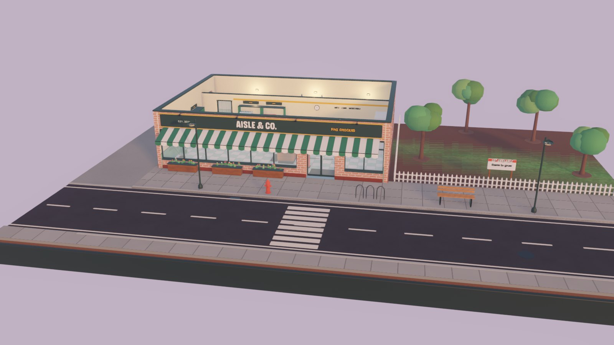

# Aisle & Co.

A cozy 3D supermarket tycoon about growing a humble corner shop into a
warehouse superstore. Built with **Godot 4.3** and **GDScript**.



## Status

This is an early but genuinely playable milestone: one corner shop, a
complete trading day, construction, stock, staff and saves. See
[`docs/DEVLOG.md`](docs/DEVLOG.md) for exactly what works, what was verified
and how, and what isn't built yet.

## Running

1. Install Godot **4.3** (standard build, not .NET).
2. Open `project.godot` in the editor, or run:

```bash
godot --path .
```

The game uses the Forward+ renderer (Vulkan).

## Controls

| Input | Action |
| --- | --- |
| W A S D / arrows | Pan the camera |
| Right-drag | Orbit and tilt |
| Middle-drag | Grab-pan (the ground stays under the cursor) |
| Mouse wheel | Zoom toward the cursor |
| Q / E | Rotate |
| T | Toggle top-down view |
| F | Focus the selection |
| B | Build menu |
| R / Shift+R | Rotate the piece being placed |
| X | Sell tool |
| Ctrl+Z | Undo construction |
| O | Stock & orders |
| H | Staff |
| V | Cycle wall cutaway (auto / up / down) |
| Space, 1, 2, 3 | Pause, normal, fast, fastest |
| Esc | Cancel / close / pause menu |

## How to play

- Before 08:00 you're **setting up**. Arrange fixtures, then press **Open doors**
  (or just wait).
- Shoppers arrive with lists and budgets. They take real units off real
  shelves, so watch the stock bars in the inspector (click any shelf).
- **Order stock** (O) from the wholesaler. A van delivers to the side door about
  an hour later, and the cases go onto your stockroom racks.
- **You are the owner.** You work the till when shoppers queue and restock
  shelves in between. Hire a cashier or a stocker (H) once you can afford it.
- **Prices** affect who buys. Shoppers compare your price with what they think
  is fair.
- At closing time you get a day report with plain-language takeaways.

## Tests

```bash
godot --headless --path . res://tests/test_runner.tscn
```

The suite covers ledger integrity, stock conservation under random
operations, placement rules, delivery, the business clock, sound levels, a
full simulated trading day, and a save/load round trip. It exits non-zero on
failure.

## Project layout

```
src/core     Game autoload (fixed-step loop), settings, saves, selection
src/sim      Catalog, store layout & validation, inventory, economy, clock
src/agents   Shoppers, staff, checkout lanes, person animation
src/build    Construction tool
src/world    Lot, grid & navigation, world builder, fixture views, atmosphere
src/art      Mesh kit, materials, palette, fixture/product/person models
src/ui       Theme, icons, HUD and windows
src/audio    Synthesised sound effects
data/        ProductDef and FixtureDef resources
shaders/     Procedural surfaces (tiles, brick, plaster, wood, terrain)
tools/       Data generator, screenshot/capture tool
tests/       Headless test suite
docs/        Art direction, architecture, dev log
```

## Credits and licences

- Fonts: Bricolage Grotesque and Figtree, SIL Open Font License
  (see `assets/fonts/`).
- All 3D models, icons, shaders and sounds are original to this project and are
  generated by code in this repository.
